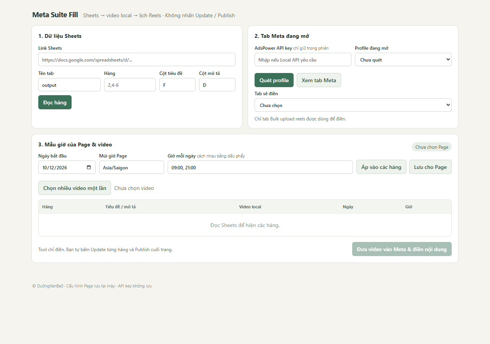

# Meta Suite Fill

Tool local đọc Google Sheets, chọn một hoặc nhiều video trên máy và điền vào tab **Bulk upload reels** đang mở trong AdsPower. Tool **không nhấn Update, Publish, Save as draft**. Bạn xác nhận từng lịch và lần xuất bản cuối trên Meta.

## Cài và chạy trên Windows

1. Cài Node.js 20 trở lên.
2. Mở PowerShell trong thư mục này, chạy `npm install` rồi `npm start`.
3. Mở `http://127.0.0.1:38917` trên máy đó. Giữ cửa sổ PowerShell chạy khi dùng tool.
4. Mở profile AdsPower và vào trang **Meta Business Suite → Bulk upload reels** bằng chính profile đó. Đăng nhập Meta bằng tay.

Tool ưu tiên AdsPower Local API. Nếu API yêu cầu key, bạn có thể nhập vào ô password của tool; key chỉ giữ trong tab tool và không được lưu. Khi không có key, tool tự tìm cổng CDP của **profile đã mở** trên máy. Profile cần mở trước khi bấm **Quét profile**. Tool không khởi động hay đóng profile.

## Cách dùng

1. Nhập URL Google Sheets, tên tab, hàng (`2,4-6`), cột tiêu đề và cột mô tả. Sheet phải cho phép xem bằng liên kết. Các ô này **tự lưu trên máy khi thay đổi** và tự khôi phục khi mở lại tool. Bấm **Đọc hàng**.
2. Bấm **Quét profile**, chọn profile → **Xem tab Meta** → chọn tab `bulk_upload_composer`. Tool chỉ điền trên tab được chọn.
3. **Ngày bắt đầu mặc định là hôm nay** mỗi lần mở tool, kể cả khi lần trước đã chọn ngày khác. Nhập mẫu giờ, ví dụ `19,21,23 | 7,9`. Dấu `|` chuyển sang ngày kế; nếu nhập `19,21,23,7,9`, tool cũng tự chuyển ngày khi giờ giảm. Năm hàng sẽ nhận lần lượt 19:00, 21:00, 23:00 ở ngày bắt đầu và 07:00, 09:00 ở ngày kế. Từ hàng thứ sáu, mẫu lặp ở ngày thứ ba. Bấm **Lưu giờ cho tất cả Page** để dùng chung mẫu giờ này khi đổi Page hoặc mở lại tool. Bấm **Áp vào các hàng** để xem ngày/giờ từng hàng trong bảng và chỉnh riêng nếu cần. Múi giờ được đọc từ Meta theo từng Page khi điền lịch.
4. Bấm **Chọn nhiều video một lần** để ghép hàng loạt: hộp chọn mở tại thư mục video đã chọn lần trước (lần đầu bạn tự mở thư mục); file có tiền tố số hàng như `18_video.mp4` ghép với hàng 18, các file khác ghép theo thứ tự trình chọn file trả về. Hoặc bấm **Chọn 1** ngay ở từng hàng để chọn riêng một video mà không làm mất lựa chọn của hàng khác. **Kiểm tra bảng ghép** và đổi dropdown nếu cần.
5. Khi đã chọn video cho mọi hàng, bấm **Đăng ngay tất cả** để đưa chúng vào Meta và chọn Publish now; nút này không dùng ngày/giờ. Nếu muốn hẹn lịch, bấm **Hẹn giờ tất cả**. Với từng video riêng, bấm **Đăng ngay** hoặc **Hẹn giờ** tại hàng; các hàng khác có thể chưa chọn file. Tool chờ Meta hiện dòng video và kiểm tra tên file; nếu không ghép chắc chắn, tool yêu cầu bạn chỉ rõ dòng Meta tương ứng.
6. Tool tự chọn Publish now cho hàng đầu tiên trong lượt **Đăng ngay tất cả**. Với hàng **Hẹn giờ**, bấm nút trong phần Tiến trình để tool chọn Schedule và điền ngày/giờ. **Bạn tự bấm Update trên Meta** sau mỗi hàng, rồi bấm **Đã bấm Update → ...** trong tool để chuyển sang hàng tiếp theo. Với **Đăng ngay**, bạn cũng tự bấm Update và Publish trên Meta.
7. Kiểm tra toàn bộ danh sách trên Meta và **tự bấm Publish** nếu mọi thứ đúng.

Nếu điền lịch lỗi và muốn làm lại, bấm **Xóa video lượt này trên Meta** trong phần Tiến trình. Tool hỏi xác nhận, sau đó chỉ xóa các dòng video đã ghép với lượt hiện tại; nội dung và giờ của các dòng đó cũng mất. Các file local không bị xóa, nên bạn có thể bấm **Hẹn giờ** hoặc **Đăng ngay** tại hàng để điền lại. Nếu Meta đổi nút xóa hoặc dòng không còn khớp, tool dừng và yêu cầu bạn kiểm tra/xóa trực tiếp trên Meta. Nút này không bấm Update hay Publish.

Tài khoản có ô Title: tool điền tiêu đề tối đa 200 ký tự vào Title, và điền `tiêu đề tối đa 200 ký tự + hai dấu xuống dòng + mô tả` vào Description. Tài khoản chỉ có Description: tool điền cùng chuỗi đó. Tiêu đề được cắt theo ký tự hiển thị để không chẻ đôi emoji. Phần mô tả không bị cắt.

Ô mô tả Sheets có thể bắt đầu bằng `[FILE D:\duong-dan\mo-ta.txt]` như Auto Fill Blog; tool đọc file `.txt` hoặc `.md` local tối đa 10 MB.

## Dữ liệu và giới hạn

- Mô tả từ Sheets hoặc file local được xóa link web (`https://`, `www.`, domain như `fb.watch/...` và link Markdown) trước khi hiển thị và điền vào Meta; phần chữ còn lại được giữ.
- Nếu khởi động lại tool giữa lượt điền, lượt cũ không còn. Tab tool đang mở sẽ tắt nút Tiếp và yêu cầu kiểm tra các video/lịch đã có trên Meta trước khi bắt đầu lượt mới.
- Video được gửi trực tiếp từ đường dẫn local vào trình chọn file của tab Meta; không tải video lên máy chủ khác.
- URL Sheets, tab, hàng, cột, mẫu giờ dùng chung và thư mục video đã chọn gần nhất được lưu trong `user-data.json` trên máy này. Múi giờ vẫn được lưu theo `asset_id` của từng Page; ngày bắt đầu luôn hiện hôm nay khi mở tool. File này nằm trong `.gitignore`. API key và đường dẫn từng file video không lưu.
- Tối đa 50 hàng mỗi lượt. Tool không tự nhấn Update/Publish và không ghi ngược vào Sheets.
- Meta có thể đổi cấu trúc ô nhập giữa các tài khoản. Nếu tool không xác định chắc dòng video hoặc ô lịch, nó dừng ở bước đó để tránh điền nhầm. Muốn kiểm thử phần lịch trên tài khoản của bạn, phải có tab Bulk upload reels đang mở với ít nhất một video thử.

Kiểm tra logic cơ bản bằng `npm test`. © Du0ngVanBa0.
